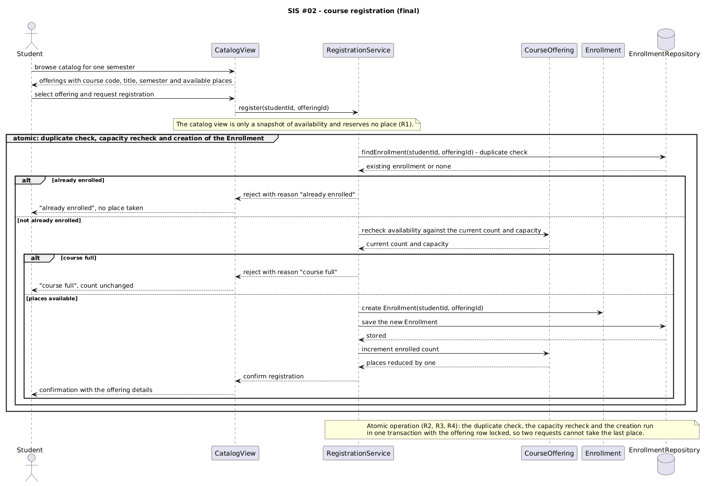
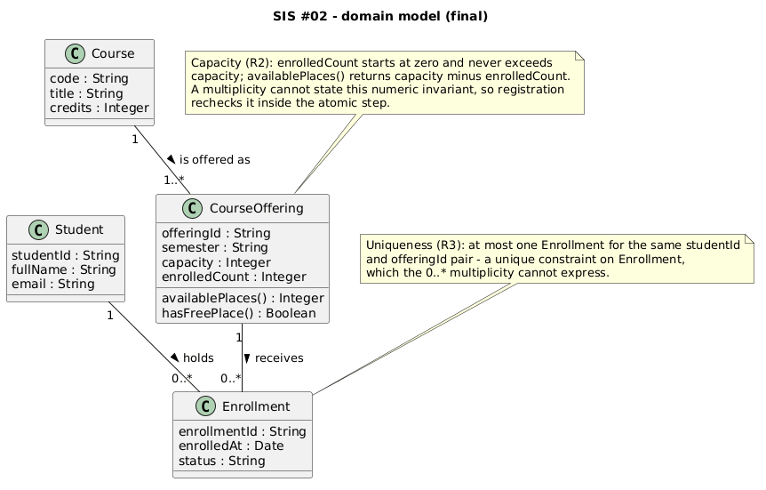
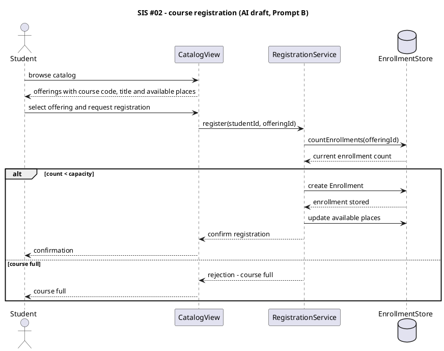
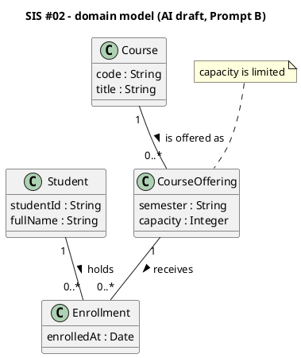
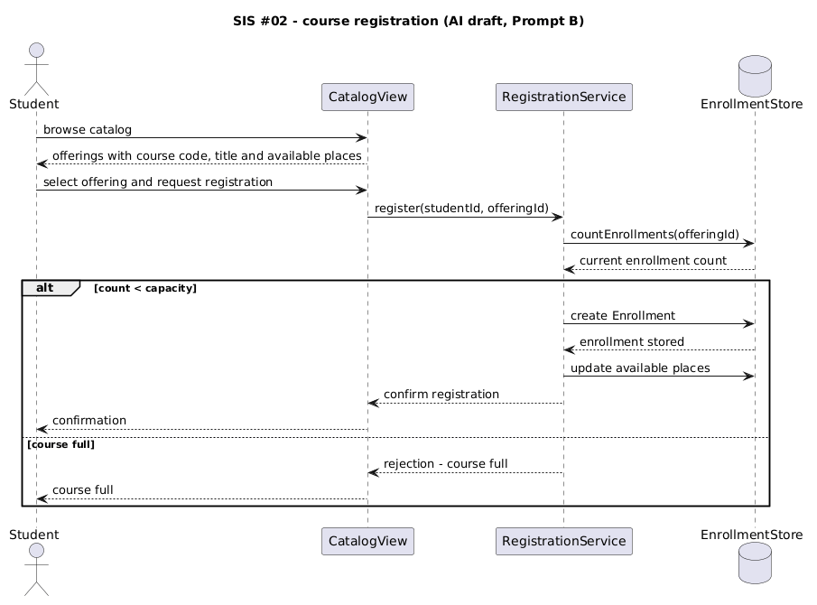
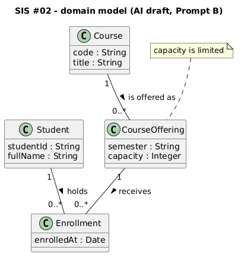

# SIS #02 — AI-Assisted UML Modeling: University Course Registration

<!--
  This is the only file you write your report in. README.md tells you what goes where.

  Rules the checker relies on:
  - Do not delete, rename or renumber the ## headings, the ### headings, or the **Label:** words.
  - Replace every "(write here)" and "(paste here)". None may be left when you submit.
  - Comments like this one are ignored by the checker and the word counter. Delete them or leave them.
-->

## 1. Scope and assumptions

<!-- Your FINAL scope statement and assumptions, after reviewing Prompt A's output. Say here
     what is out of scope (payments, prerequisites, timetable clashes, waiting lists,
     cancellation) — section 2 must not mention them. Section 10 keeps your first version. -->

**Scope:** The system lets a signed-in student view one semester's electronic course catalogue, select a single course offering and request registration. Registration either creates exactly one Enrollment for that student and offering, or it is refused with an explicit reason; the number of enrollments never exceeds the offering's capacity, and one student holds at most one enrollment in an offering. Payments, prerequisites, timetable clashes, waiting lists and cancellation are out of scope.

**Assumptions:**

1. The student is signed in before browsing, so authentication and identity management stay outside the model.
2. The selected offering exists in the current semester, its capacity is a positive whole number, and registration never changes that capacity.
3. The catalogue shows a snapshot of availability: places equal capacity minus the current enrollment count, and viewing the catalogue reserves nothing.

## 2. User stories and acceptance criteria

<!-- Your APPROVED requirements: Prompt A's draft after your review. Keep the IDs, the three
     story headings and the bullet shape. Every criterion names the rule(s) it maps to,
     e.g. (R2, R4). Two criteria per story. Nothing out of scope.
     Format of a criterion, on one bullet:
     - **AC-03** (R2, R4): Given ..., When ..., Then ... -->

### US-01 — Browse offerings

**US-01:** As a student, I want to browse one semester's course catalogue and see every offering with its course code, title and available places, so that I can choose an offering that still has room.

- **AC-01** (R1): Given a signed-in student and an existing offering in the current semester, When the student opens the catalogue, Then the offering is shown with its course code, course title, semester and the number of available places.
- **AC-02** (R1, R2): Given a student is looking at an offering in the catalogue, When the page shows its available places, Then that number equals the capacity minus the current enrollment count, and viewing the catalogue reserves no place.

### US-02 — Register for an offering

**US-02:** As a student, I want to request registration for one chosen offering, so that I obtain exactly one place in it while a place is still free.

- **AC-03** (R2, R4): Given an offering with capacity 2 and one existing enrollment, When a student without an enrollment in it requests registration, Then exactly one Enrollment is created, the available places become 0 and a confirmation is returned.
- **AC-04** (R2, R3, R4): Given a registration request arrives, When the service starts processing it, Then the duplicate check, the capacity recheck and the creation of the Enrollment run as one atomic operation, so that no second request can take the same last place.

### US-03 — Receive a clear rejection

**US-03:** As a student, I want a clear reason when my registration is refused, so that I understand why no place was given to me.

- **AC-05** (R2, R5): Given the current enrollment count already equals the offering's capacity, When a student requests registration, Then the service answers "course full", creates no Enrollment and leaves the count unchanged.
- **AC-06** (R3, R5): Given the student already holds an Enrollment in that offering, When the same student requests registration again, Then the service answers "already enrolled", creates no second Enrollment and leaves the count unchanged.

## 3. Sequence diagram

<!-- The FINAL diagram, rendered. Change .png to .svg if that is what you exported. -->



**Participants:** `Student` is the signed-in person who browses and requests registration. `CatalogView` is the boundary that renders the catalogue and shows the result. `RegistrationService` is the control object that performs the two checks and creates the Enrollment. `CourseOffering` is the domain object that owns capacity and the current count. `Enrollment` is the record created for a successful registration. `EnrollmentRepository` answers the duplicate query and persists the new record.

**Atomic operation:** the duplicate check (`findEnrollment(studentId, offeringId)`), the capacity recheck (`recheck availability against the current count and capacity`) and the creation of the Enrollment (`create Enrollment`, `save the new Enrollment`, `increment enrolled count`) all sit inside the group `atomic: duplicate check, capacity recheck and creation of the Enrollment`, and the note below it states that they run in one transaction with the offering row locked. A catalogue view is outside that group because it only reads a snapshot: R1 asks for availability to be shown, and showing it reserves nothing, so no place is taken until the Enrollment is created.

**Where the Enrollment is created:** the message `create Enrollment(studentId, offeringId)`, sent by `RegistrationService` to the `Enrollment` lifeline inside the `places available` branch, produces one instance of the class `Enrollment` of section 4; `save the new Enrollment` then persists it through `EnrollmentRepository`.

**Technical lifelines:** `CatalogView` (a boundary), `RegistrationService` (a control service) and `EnrollmentRepository` (a repository) are not classes in the class diagram. The difference in abstraction is deliberate: the class diagram shows the persistent domain concepts, while the sequence diagram also has to show the components that carry out the checks, so the three technical lifelines appear only in the interaction.

## 4. Class diagram

<!-- The FINAL diagram, rendered. -->



<!-- One row per association in classes.puml, read in both directions. -->

| Association | Read left to right | Read right to left |
| --- | --- | --- |
| Student — Enrollment (1 to 0..*) | A Student holds zero or more Enrollment records | Each Enrollment belongs to exactly one Student |
| CourseOffering — Enrollment (1 to 0..*) | A CourseOffering receives zero or more Enrollments | Each Enrollment is made for exactly one CourseOffering |
| Course — CourseOffering (1 to 1..*) | A Course is offered as one or more CourseOfferings | Each CourseOffering is a section of exactly one Course |

**How an Enrollment links a student to an offering:** Enrollment is the association record between the two: it holds `enrollmentId`, `enrolledAt` and `status`, and its two mandatory ends tie exactly one Student to exactly one CourseOffering, so one Enrollment instance is exactly one registration of that student in that offering.

**Capacity constraint:** `enrolledCount` must stay between zero and `capacity`, and `availablePlaces()` returns the difference. The `0..*` on the Enrollment end only says how many links may exist; it says nothing about the values stored in the offering, so multiplicity alone cannot express a numeric limit and the constraint has to be written as a note and enforced by the recheck inside the atomic step (R2).

**Uniqueness constraint:** there is at most one Enrollment for a given `studentId` and `offeringId` pair. Multiplicity again counts links rather than combinations of values: `0..*` happily allows a second Enrollment between the same student and the same offering, so the uniqueness has to be stated as its own constraint on Enrollment (R3).

## 5. Traceability

<!-- Every rule, including the catalog fields and availability (R1). Column 1: the rule and
     the criteria that cover it, e.g. "R2 + AC-03, AC-04". Column 2: the message, guard,
     class or constraint that shows the rule in YOUR diagrams. Column 3: the T-ID that
     exercises it, or the extra check you did instead (R1 has no T case). -->

| Rule and criterion | Model evidence | Validation case |
| --- | --- | --- |
| R1 + AC-01, AC-02 | the two catalogue messages, `Course.code` and `Course.title`, `CourseOffering.semester` and `availablePlaces()`, and the note that a view reserves nothing | T1 |
| R2 + AC-02, AC-03, AC-05 | the atomic group, `recheck availability against the current count and capacity`, the capacity note and `increment enrolled count` inside the group | T2 and T3 |
| R3 + AC-04, AC-06 | `findEnrollment(studentId, offeringId)` before creation, the `already enrolled` branch and the uniqueness note on Enrollment | T4 |
| R4 + AC-03, AC-04 | `create Enrollment`, `save the new Enrollment`, and `confirm registration` only after the record exists | T2 |
| R5 + AC-05, AC-06 | the two rejection branches, which return the reason and change no state | T3 and T4 |

## 6. Walkthroughs

<!-- Walk each case through YOUR final sequence diagram, message by message. Column 2: the
     actual steps and the state change (count before → after). Column 3 starts with Pass or
     Fail, then the location: the message, guard or note where you saw it. A Fail you
     report honestly is a finding, not a penalty. -->

| Case | Observed path and state change | Judgment and evidence |
| --- | --- | --- |
| T1. Available | Open the catalogue: `browse catalog for one semester` returns `offerings with course code, title, semester and available places`. State change: none, enrolledCount stays at 1 of capacity 2, so two places are shown and nothing is reserved. | Pass. `models/sequence.puml`, the first two messages and the note `a snapshot of availability and reserves no place`; `availablePlaces()` in `models/classes.puml`. |
| T2. Last place | With one enrollment and capacity 2, the student sends `request registration`; `findEnrollment` returns none, `recheck availability` returns count 1 against capacity 2, so the `places available` branch runs `create Enrollment`, `save the new Enrollment` and `increment enrolled count`. State change: enrolledCount 1 → 2, places 1 → 0, then `confirm registration`. | Pass. `models/sequence.puml`, group `atomic`, branch `places available`, messages `create Enrollment` through `confirm registration`. |
| T3. Full | The student loaded the catalogue while one place remained; another request took it. On `request registration`, `findEnrollment` returns none, then `recheck availability` returns count 2 against capacity 2, so the `alt course full` branch answers `reject with reason "course full"` and reaches the student as `"course full", count unchanged`. State change: none, enrolledCount stays 2. | Pass. `models/sequence.puml`, inner `alt course full` branch; the guard is evaluated on the re-read count, not on the catalogue snapshot. |
| T4. Duplicate | The same student requests the same offering again. `findEnrollment(studentId, offeringId)` returns the existing record, so `alt already enrolled` runs `reject with reason "already enrolled"` and no create, save or increment message is reached. State change: none, one Enrollment remains. | Pass. `models/sequence.puml`, `alt already enrolled` branch before the capacity recheck; uniqueness note on Enrollment in `models/classes.puml`. |

## 7. Review decisions

<!-- At least three substantive decisions about Prompt C's critique or your own inspection.
     Decision: accepted / rejected / modified — and what you did. Reason: why, in a full
     sentence. Rule: R1–R5. Do not invent an error to fill the table; a justified rejection
     of advice counts. -->

| AI suggestion or model element | Decision | Reason | Rule |
| --- | --- | --- | --- |
| Draft AC-02: mark a full offering and add the student to its waiting list | rejected | Waiting lists are excluded by the scope in section 1, so the criterion now only reports availability and reserves nothing. | R1 |
| Draft AC-04: create the enrollment because availability was checked when the catalog page loaded | rejected, then rewritten | A catalogue snapshot can be stale, so registration must recheck the live count and treat that check and the creation as one atomic step. | R2 |
| Sequence draft with no duplicate check before `create Enrollment` | accepted, added | Without `findEnrollment` a second request would create a second record for the same student and offering, which breaks uniqueness. | R3 |
| Class note `capacity is limited` | modified | The note gave no checkable value, so it now states the range of enrolledCount against capacity and names the derived operation. | R2 |
| Technical lifeline `EnrollmentStore` | accepted with a rename | A repository is an implementation detail rather than a domain concept, so `EnrollmentRepository` keeps the lifeline and makes the abstraction explicit. | R4 |

## 8. Modeling explanation

<!-- 200–300 words. Your main design choices; how the class diagram and the sequence diagram
     complement each other; why an activity diagram could also help explain the workflow. -->

The model keeps three concerns apart: a catalogue that only reports availability, a service that decides, and an Enrollment record that makes a decision permanent. My first choice was to keep exactly the four domain classes the assignment names, so the class diagram reads as the persistent vocabulary of the system rather than an inventory of every class an implementation might need. CourseOffering holds capacity and enrolledCount together, which makes availability a derived value instead of a stored counter that can drift; availablePlaces() and hasFreePlace() exist only to make that derivation explicit.

The sequence diagram adds the ordering that a class diagram cannot show. Availability is read twice for different reasons: once when the catalogue is rendered, which reserves nothing, and once inside the atomic group immediately before the Enrollment is created. That second read is what protects the last place when two students press register at the same moment. The group and its note carry the transaction boundary, and both rejection branches return a reason without touching state, so R5 is visible in the interaction and not only in the prose.

The two diagrams complement each other: the class diagram says what an Enrollment is and which constraints hold for every instance, while the sequence diagram says when those constraints are checked and in what order. An activity diagram would add a third view that neither gives today — the workflow as a flow of decisions, with browsing as the entry point and the two rejections as alternative exits. It would show a reader who does not read lifelines that the duplicate check comes before the capacity check, and where the atomic step sits in the end-to-end process.

## 9. Reflection

<!-- 150–200 words. Written by you, not by the assistant: where AI helped, one decision you
     made yourself, one remaining limitation. Specific beats flattering. -->

What surprised me was how plausible the first draft looked. Prompt A produced six clean criteria, and only when I traced AC-02 did I notice that it had quietly added a waiting list, which my own scope statement had already excluded two days earlier. Comparing the old scope against the new requirement was the most useful ten minutes of the assignment. The decision I would defend in a viva is keeping the catalogue read outside the atomic block: wrapping a screen in a transaction felt wrong, and once I wrote the note that a view reserves nothing, the rest of the sequence diagram fell into place, including why the count has to be read again just before creation.

AI helped most with the mechanical translation of prose rules into guards and multiplicities, and least with judgement: it never asked whether four classes were enough, and its class diagram treated uniqueness as an afterthought. The remaining limitation is that capacity is still modelled as fixed; a real system lets an administrator change it mid-semester, and my atomic group does not say what happens to a request that is already in flight.

## 10. Appendix A — Before AI

<!-- Written BEFORE you run Prompt A, committed and pushed in your first commit, and never
     edited afterwards. This is what you paste into Prompt A as "My initial assumptions". -->

**Scope:** A signed-in student browses one semester's electronic course catalogue, selects a course offering and requests registration; the system creates at most one Enrollment for that student and offering, and refuses the request when the offering has no places left or the student is already enrolled.

**Initial assumptions:**

1. The student is already signed in, so authentication and identity management stay outside this model.
2. Every offering shown in the catalogue already exists and its capacity is a positive whole number.
3. The catalogue display is informational: a place is taken only when an Enrollment record is created during registration.
4. Payments, prerequisites, timetable clashes, waiting lists and cancellation are out of scope for this model.

## 11. Appendix B — AI exchanges

<!-- Complete prompts and complete responses, as text — never screenshots. Paste each inside
     the ~~~~ block that follows its label: AI responses contain ``` PlantUML blocks, and
     ~~~~ keeps them from breaking this file. Prompts B and C: the prompt text first, then
     the material it refers to ("below", "these two") pasted under it, in the same block.
     You may add B5, B6 … after B4 if you ran more. -->

### B1 — Requirements (Prompt A)

- **Tool:** Cline (VS Code extension)
- **Model:** not displayed
- **Date:** 2026-10-18
- **Purpose:** draft 3 user stories and 6 acceptance criteria

<!-- Model: the exact model with its version, as the tool shows it (e.g. "GPT-5 Thinking",
     "Claude Sonnet 4.5"). If the tool does not show it, write: not displayed
     Date: YYYY-MM-DD -->

**Prompt:**

~~~~text
Act as a requirements analyst. Use only this course registration scenario and rules R1–R5: A student browses an electronic course catalog, chooses a course offering and requests registration; each offering has a limited number of places. A Course describes a subject. A CourseOffering is one scheduled section in one semester. Registration always targets a specific offering. Assume that the student is signed in, the selected offering exists, and its capacity is a positive whole number. Exclude payments, prerequisites, timetable clashes, waiting lists and cancellation. Use fictional students and courses. R1 Catalog: show the course code, title, offering and available places for one semester. R2 Capacity: recheck current availability when registering; enrollment must never exceed the offering's capacity. R3 Duplicates: a student may have at most one enrollment in the same offering; reject a repeat request. R4 Success: create exactly one Enrollment linking the student and offering, update availability and return a confirmation. R5 Rejection: explain "course full" or "already enrolled"; create no enrollment and leave the enrollment count unchanged. My initial assumptions are (1) the student is already signed in, so authentication and identity management stay outside this model; (2) every offering shown in the catalogue already exists and its capacity is a positive whole number; (3) the catalogue display is informational: a place is taken only when an Enrollment record is created during registration; (4) payments, prerequisites, timetable clashes, waiting lists and cancellation are out of scope for this model.
Draft 3 user stories and 2 Given / When / Then acceptance criteria for each. Use IDs US-01 to US-03 and AC-01 to AC-06. Map each criterion to rule IDs.
Cover normal and rejection behavior. List uncertainty separately. Do not add excluded features or invent university policies.
~~~~

**Response:**

~~~~text
US-01 — Browse offerings
US-01: As a student, I want to browse the catalog, so that I can find a course to register for.
AC-01 (R1): Given the student is signed in, When they open the catalog for the current semester, Then each offering is listed with its course code, title, semester and available places.
AC-02 (R1): Given an offering is full, When the student views it in the catalog, Then it is marked as full and the student is added to the waiting list for that offering.

US-02 — Register for an offering
US-02: As a student, I want to register for an offering, so that I get a place in it.
AC-03 (R2, R4): Given the offering shows available places, When the student requests registration, Then the system creates one enrollment and returns a confirmation.
AC-04 (R2): Given the catalog shows one free place, When the student presses register, Then the enrollment is created, because availability was already checked when the catalog page was loaded.

US-03 — Clear rejection
US-03: As a student, I want to be told why my registration was refused.
AC-05 (R2, R5): Given the offering is full, When the student requests registration, Then the system replies "course full" and creates no enrollment.
AC-06 (R3): Given the student is already enrolled in the offering, When the student requests registration again, the system replies "already enrolled" and creates no second enrollment.

Uncertainty
- Whether the capacity check should be repeated at registration time or whether the figure shown by the catalog is reliable enough.
- Whether a student may hold enrollments in several offerings of the same course in one semester.
- What should happen when an administrator changes an offering's capacity in the middle of the registration period.
- How a rejection should be worded for a student who is both already enrolled and facing a full offering.
- Whether the confirmation needs to state the remaining places or only the offering details.

Assumptions I made: the student identity comes from the signed-in session, one offering belongs to exactly one course, and no other university policies apply. If you want, I can also draft a first PlantUML sequence diagram for the registration flow or convert these criteria into a test checklist.
~~~~

### B2 — UML drafts (Prompt B)

- **Tool:** Cline (VS Code extension)
- **Model:** not displayed
- **Date:** 2026-10-18
- **Purpose:** draft the sequence and class diagrams

**Prompt:**

~~~~text
Using my approved scenario, R1–R5, stories and criteria below, return separate PlantUML code blocks for a sequence diagram and a domain class diagram.
Sequence: include catalog browsing and guarded success, full-course and duplicate outcomes. Model final checks and creation as one atomic operation.
Class: show domain concepts, useful attributes and multiplicities. State the capacity and uniqueness constraints. Explain assumptions and any technical lifelines.

Scenario: a student browses an electronic course catalog, chooses a course offering and requests registration; each offering has a limited number of places. A Course describes a subject, a CourseOffering is one scheduled section in one semester, and registration always targets a specific offering. The student is signed in, the selected offering exists, and its capacity is a positive whole number. Payments, prerequisites, timetable clashes, waiting lists and cancellation are out of scope.

Rules: R1 Catalog - show the course code, title, offering and available places for one semester. R2 Capacity - recheck current availability when registering; enrollment must never exceed the offering's capacity. R3 Duplicates - a student may have at most one enrollment in the same offering; reject a repeat request. R4 Success - create exactly one Enrollment linking the student and offering, update availability and return a confirmation. R5 Rejection - explain "course full" or "already enrolled"; create no enrollment and leave the enrollment count unchanged.

Approved requirements:
US-01: As a student, I want to browse one semester's course catalogue and see every offering with its course code, title and available places, so that I can choose an offering that still has room.
AC-01 (R1): Given a signed-in student and an existing offering in the current semester, When the student opens the catalogue, Then the offering is shown with its course code, course title, semester and the number of available places.
AC-02 (R1, R2): Given a student is looking at an offering in the catalogue, When the page shows its available places, Then that number equals the capacity minus the current enrollment count, and viewing the catalogue reserves no place.
US-02: As a student, I want to request registration for one chosen offering, so that I obtain exactly one place in it while a place is still free.
AC-03 (R2, R4): Given an offering with capacity 2 and one existing enrollment, When a student without an enrollment in it requests registration, Then exactly one Enrollment is created, the available places become 0 and a confirmation is returned.
AC-04 (R2, R3, R4): Given a registration request arrives, When the service starts processing it, Then the duplicate check, the capacity recheck and the creation of the Enrollment run as one atomic operation, so that no second request can take the same last place.
US-03: As a student, I want a clear reason when my registration is refused, so that I understand why no place was given to me.
AC-05 (R2, R5): Given the current enrollment count already equals the offering's capacity, When a student requests registration, Then the service answers "course full", creates no Enrollment and leaves the count unchanged.
AC-06 (R3, R5): Given the student already holds an Enrollment in that offering, When the same student requests registration again, Then the service answers "already enrolled", creates no second Enrollment and leaves the count unchanged.
~~~~

**Response:**

~~~~text
Here are the two PlantUML drafts. Sequence diagram: the student browses the catalog through CatalogView, then CatalogView forwards register(studentId, offeringId) to RegistrationService. The service asks EnrollmentStore for the current count and compares it with capacity inside one alt block; the success branch creates the Enrollment and updates availability, and the course-full branch returns a rejection. I modelled the store as a technical lifeline (a repository in the implementation) rather than a domain class, because the domain classes are Student, Course, CourseOffering and Enrollment. Class diagram: Student holds enrollments, a CourseOffering receives enrollments, and a Course is offered as one or more CourseOfferings. Multiplicities are written at both ends. Capacity is attached to CourseOffering as an attribute and repeated in a note, and the draft assumes one offering belongs to exactly one course and that an offering's capacity is fixed while registration is open. I did not model the duplicate check explicitly, and I left the atomicity of the final check and the creation to the implementation, so you may want a note or a critical block around those messages. Both blocks can be pasted as-is into .puml files and rendered by the PlantUML server.




~~~~

### B3 — Model critique (Prompt C)

- **Tool:** Cline (VS Code extension)
- **Model:** not displayed
- **Date:** 2026-10-18
- **Purpose:** review both models against R1–R5 and T1–T4

**Prompt:**

~~~~text
Review these two UML models against R1–R5 and my acceptance criteria. Check message order, guards, state changes, multiplicities and naming.
Inspect the four validation cases: available places, exactly one place, full course after a stale catalog view, and duplicate registration.
For each issue, cite the affected rule and model element. Explain the impact and propose a focused correction. Separate genuine defects from optional design choices.

Rules: R1 Catalog - course code, title, offering and available places for one semester. R2 Capacity - recheck current availability when registering; enrollment must never exceed capacity. R3 Duplicates - at most one enrollment per student and offering; reject a repeat request. R4 Success - exactly one Enrollment linking student and offering, availability updated, confirmation returned. R5 Rejection - explain "course full" or "already enrolled", create nothing, leave the count unchanged.

Acceptance criteria:
AC-01 (R1): catalogue shows code, title, semester and available places.
AC-02 (R1, R2): available places equal capacity minus the current count; viewing reserves nothing.
AC-03 (R2, R4): with one free place left, exactly one Enrollment is created, places become 0 and a confirmation is returned.
AC-04 (R2, R3, R4): the duplicate check, the capacity recheck and the creation are one atomic operation.
AC-05 (R2, R5): when the count equals capacity the answer is "course full" and nothing is created.
AC-06 (R3, R5): when the student already holds an Enrollment the answer is "already enrolled" and no second record is created.

Sequence model:


Class model:

~~~~

**Response:**

~~~~text
Genuine defects

1. R3 — the sequence diagram has no duplicate check. Between register(studentId, offeringId) and create Enrollment the only read is countEnrollments(offeringId). T4 therefore reaches create Enrollment and produces a second Enrollment for the same student and offering: the model contradicts AC-06. Correction: after the request, send findEnrollment(studentId, offeringId); if a record exists, take an alt already enrolled branch that returns the reason and stops.

2. R2, AC-04 — the capacity check and the creation are not atomic. countEnrollments is a plain read and create Enrollment is a separate message with no lock, so two concurrent requests can both observe one enrollment of two and both insert, ending at three Enrollments for capacity two (T2 then T3). Correction: wrap the final duplicate check, the capacity recheck and the creation in one atomic block, or in a critical block, and say in a note that the offering row is locked for the transaction.

3. R2, R4 — update available places is a second write after the Enrollment exists. If places are stored they can drift from the counted rows, and a failure between the two messages leaves the offering inconsistent. Correction: derive available places as capacity minus the enrollment count, or perform the increment in the same transaction.

4. R5 — the course-full branch is correct: it returns "course full" and creates nothing. The duplicate reason, however, is absent because the branch itself is absent (see 1), so R5 is only half covered.

5. Class diagram, R3 — Student "1" -- "0..*" Enrollment allows several Enrollments, and no constraint says that the pair studentId/offeringId is unique. Multiplicity counts links between instances, not combinations of attribute values, so this has to be a constraint note on Enrollment.

6. Class diagram, R2 — the note "capacity is limited" is not checkable. Replace it with the invariant enrolledCount between zero and capacity and mention that the comparison uses a re-read count inside the atomic step. availablePlaces() is a useful derived operation to add.

7. T3 — the diagram checks a freshly counted value, so a stale catalog view is handled correctly and the full branch is entered. A note stating that the catalog view reserves nothing would make that explicit, otherwise a reader may assume CatalogView holds a place.

Optional design choices, not defects

- EnrollmentStore as a technical lifeline is fine: it is a repository, not a domain class, and the class diagram may omit it provided the report explains the difference.
- register(studentId, offeringId) passing identifiers rather than object references is a valid choice.
- CatalogView could be drawn as a boundary instead of a participant.
- Course "1" -- "0..*" CourseOffering allows a course with no offering, which is acceptable in a catalogue.
- Enrollment.enrolledAt is not required by R1-R5 but is harmless and useful for auditing.
~~~~

### B4 — Focused revision (Prompt D)

- **Tool:** Cline (VS Code extension)
- **Model:** not displayed
- **Date:** 2026-10-18
- **Purpose:** apply my accepted review decisions

**Prompt:**

~~~~text
Revise the UML sources using only my accepted review decisions:
1. Add the duplicate check findEnrollment(studentId, offeringId) immediately after the registration request, with an alt already enrolled branch that returns the reason and creates nothing.
2. Put the duplicate check, the capacity recheck and the creation of the Enrollment into one atomic group with a note naming the transaction and the row lock.
3. Remove the separate "update available places" write and derive availability from capacity minus enrolledCount.
4. Replace the class note "capacity is limited" with a checkable capacity invariant and add availablePlaces() as a derived operation.
5. Add a uniqueness constraint note for the studentId and offeringId pair on Enrollment.
6. Rename the technical lifeline EnrollmentStore to EnrollmentRepository and keep CatalogView as a participant.
7. Add a note stating that a catalogue view reserves nothing.
Keep justified existing elements and explain each change.
Preserve the agreed scope, the four class names and the rule IDs. Return both updated PlantUML blocks and a concise change log. Flag any unresolved issue.

Original sources:


~~~~

**Response:**

~~~~text
Change log, one entry per accepted decision:

1. Duplicate check added. After the registration request, findEnrollment(studentId, offeringId) now runs before any other check, and the alt already enrolled branch returns "already enrolled" without creating anything.
2. Atomicity. The duplicate check, the capacity recheck and the creation of the Enrollment are wrapped in a group labelled atomic, and a note states that they run in one transaction with the offering row locked.
3. Available places. The separate "update available places" write is removed. Availability is derived from capacity minus enrolledCount, and the atomic step now sends "increment enrolled count" to the offering.
4. Capacity constraint. The vague note is replaced by the invariant that enrolledCount starts at zero and never exceeds capacity, and availablePlaces() is added to CourseOffering as a derived operation.
5. Uniqueness. A second note on Enrollment states that at most one Enrollment exists for the same studentId and offeringId pair.
6. Naming. EnrollmentStore is now EnrollmentRepository; CatalogView stays a participant and carries the note that a catalogue view reserves nothing.
7. Catalogue note added, so the diagram says explicitly that a view reserves no place.

Kept unchanged because they were already justified: the four domain classes and their names, the three associations with multiplicities at both ends, Enrollment.enrolledAt, and the two-message catalogue exchange.

Unresolved issue: the model does not say what happens when an administrator changes capacity while a registration is in flight. The transaction isolates the count check from that change, but the policy for a request that started before the change is a product decision, and I did not invent one.

Sequence diagram, final:

@startuml
title SIS #02 - course registration (final)

actor Student
participant "CatalogView" as CatalogView
participant "RegistrationService" as RegistrationService
participant "CourseOffering" as CourseOffering
participant "Enrollment" as Enrollment
database "EnrollmentRepository" as EnrollmentRepository

Student -> CatalogView : browse catalog for one semester
CatalogView --> Student : offerings with course code, title, semester and available places

Student -> CatalogView : select offering and request registration
CatalogView -> RegistrationService : register(studentId, offeringId)

note over CatalogView, RegistrationService
  The catalog view is only a snapshot of availability and reserves no place (R1).
end note

group atomic: duplicate check, capacity recheck and creation of the Enrollment
  RegistrationService -> EnrollmentRepository : findEnrollment(studentId, offeringId) - duplicate check
  EnrollmentRepository --> RegistrationService : existing enrollment or none

  alt already enrolled
    RegistrationService --> CatalogView : reject with reason "already enrolled"
    CatalogView --> Student : "already enrolled", no place taken
  else not already enrolled
    RegistrationService -> CourseOffering : recheck availability against the current count and capacity
    CourseOffering --> RegistrationService : current count and capacity

    alt course full
      RegistrationService --> CatalogView : reject with reason "course full"
      CatalogView --> Student : "course full", count unchanged
    else places available
      RegistrationService -> Enrollment : create Enrollment(studentId, offeringId)
      RegistrationService -> EnrollmentRepository : save the new Enrollment
      EnrollmentRepository --> RegistrationService : stored
      RegistrationService -> CourseOffering : increment enrolled count
      CourseOffering --> RegistrationService : places reduced by one
      RegistrationService --> CatalogView : confirm registration
      CatalogView --> Student : confirmation with the offering details
    end
  end
end

note over RegistrationService, EnrollmentRepository
  Atomic operation (R2, R3, R4): the duplicate check, the capacity recheck and the creation run
  in one transaction with the offering row locked, so two requests cannot take the last place.
end note

@enduml

Class diagram, final:

@startuml
title SIS #02 - domain model (final)

class Student {
  studentId : String
  fullName : String
  email : String
}

class Course {
  code : String
  title : String
  credits : Integer
}

class CourseOffering {
  offeringId : String
  semester : String
  capacity : Integer
  enrolledCount : Integer
  availablePlaces() : Integer
  hasFreePlace() : Boolean
}

class Enrollment {
  enrollmentId : String
  enrolledAt : Date
  status : String
}

Student "1" -- "0..*" Enrollment : holds >
CourseOffering "1" -- "0..*" Enrollment : receives >
Course "1" -- "1..*" CourseOffering : is offered as >

note "Capacity (R2): enrolledCount starts at zero and never exceeds\ncapacity; availablePlaces() returns capacity minus enrolledCount.\nA multiplicity cannot state this numeric invariant, so registration\nrechecks it inside the atomic step." as N1
N1 .. CourseOffering

note "Uniqueness (R3): at most one Enrollment for the same studentId\nand offeringId pair - a unique constraint on Enrollment,\nwhich the 0..* multiplicity cannot express." as N2
N2 .. Enrollment

@enduml
~~~~

## 12. Appendix C — Original diagrams

<!-- The AI's first output from Prompt B, rendered unedited from models/original/. -->





## 13. Appendix D — References and source checks

### References

<!-- Full references, one per line, each starting with "- ". Only sources you actually opened.
     Every URL used in the source checks must also appear here. Example:
     - Sommerville, I. (2016). Software Engineering, 10th ed., Global Edition. Pearson. Ch. 5. -->

- PlantUML. Sequence Diagram syntax and features, section "Grouping message". https://plantuml.com/sequence-diagram (accessed 2026-10-18).
- PlantUML. Class Diagram syntax and features, sections "Relations between classes" and "Label on relations". https://plantuml.com/class-diagram (accessed 2026-10-18).

### Source checks

<!-- At least two modeling decisions you verified. Source and locator: title + slide, page,
     section, chapter or figure — or title + URL + access date (YYYY-MM-DD). Slide numbers
     refer to the decks posted in our Teams. -->

| Modeling decision | Source and locator | What the source says | How it supports or changed your model |
| --- | --- | --- | --- |
| Four guarded alternative branches for success, full and duplicate instead of one branch with a combined condition | PlantUML sequence diagram documentation, section "Grouping message", https://plantuml.com/sequence-diagram (accessed 2026-10-18) | Grouping is written as `alt condition`, then `else condition`, then `end`; the condition belongs to the keyword line, and the rendered diagram supplies the brackets itself. | I removed the square brackets I had typed around my own guards, so `alt already enrolled` no longer renders as a link, and I kept one guarded branch per outcome so a reader can see the duplicate case separately from the capacity case. |
| Multiplicities written at both ends of every association in `classes.puml` | PlantUML class diagram documentation, section "Label on relations", https://plantuml.com/class-diagram (accessed 2026-10-18) | Cardinality is written in double quotes on each side of the relation, for example `Class01 "1" *-- "many" Class02 : contains`. | Every association is written as `Student "1" -- "0..*" Enrollment : holds >`, so the multiplicity is part of the link, which is what the CL3 reading of the diagram and the section 4 table both rely on. |
| Attaching the capacity and uniqueness constraints as notes rather than as new attributes | PlantUML class diagram documentation, section "Notes and stereotypes", https://plantuml.com/class-diagram (accessed 2026-10-18) | Notes can be declared with `note ... as N1` and linked to an element, and they are drawn beside the class they describe. | The two constraints are attached as `N1 .. CourseOffering` and `N2 .. Enrollment`, which keeps `capacity` and `enrolledCount` as the only numeric members while the invariant and the uniqueness rule stay visible next to the class they constrain. |
